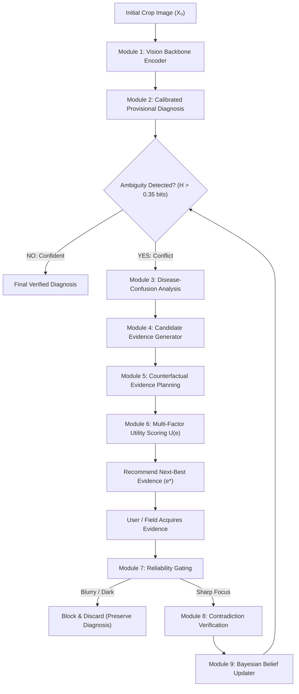

# 🌿 EvidenceGain-X

> **Counterfactual, Self-Verifying Next-Best Evidence Acquisition for Crop Disease Diagnosis**

[](https://www.python.org/downloads/)
[](https://pytorch.org/)
[-emerald.svg)](https://pytorch.org/vision/stable/models.html)
[-green.svg)](https://github.com/spMohanty/PlantVillage-Dataset)
[](https://streamlit.io/)
[](LICENSE)

---

## 📖 What is EvidenceGain-X in Simple Terms?

### The Real-World Problem with Existing Plant AI Apps
Almost every mobile crop disease app today asks only one question: **"What disease is in this photo?"**  
The user snaps a single leaf photo, and a neural network outputs a single guess.

**Why this fails in real life:**
1. **Look-Alike Diseases:** In early stages, completely different diseases look nearly identical on the leaf surface. For example, **Early Blight** (*Alternaria solani*) and **Septoria Leaf Spot** (*Septoria lycopersici*) both start as simple brown foliar spots. A standard AI is forced to make a hasty 50/50 guess.
2. **Missing Key Clues:** The decisive symptom might be physically hidden on the other side of the leaf (such as the white downy fungal mold of **Late Blight** on the abaxial underside) or on the stem. A single photo cannot see what is physically hidden.
3. **Blurry & Dark Photos:** Farmers take photos in bright sunlight, shadows, or with dirty camera lenses. Normal AI blindly processes blurry or black photos and makes confident, wrong predictions.
4. **Uploading the Wrong Leaf:** If prompted for another photo, a farmer might accidentally photograph a different healthy plant. Existing models blindly fuse contradictory data and get confused.

---

### How EvidenceGain-X Solves It: The "Doctor in the Field" Approach
EvidenceGain-X behaves like an expert agricultural pathologist:
1. **Diagnoses & Spots Ambiguity:** It evaluates the initial leaf photograph ($X_0$). If confident, it gives the diagnosis immediately. If ambiguous ($P(h_1) \approx P(h_2)$), it identifies the competing rival diseases.
2. **Asks for the Single Best Clue ($e^*$):** Instead of asking for random photos, it calculates which specific evidence will separate the rivals with the lowest effort—e.g., *"Take a macro close-up of the lesion rings"* or *"Check the underside of the leaf for white mold."*
3. **Reliability Gating (Module 7):** Before trusting your photo, it checks the pixels for blur (Laplacian variance) and lighting. If it's blurry or pitch black, it **blocks** the image and protects the diagnosis.
4. **Contradiction Verification (Module 8):** If you upload a healthy leaf from another plant by mistake, the system flags the contradiction and dampens confidence instead of making a wrong diagnosis.
5. **Adaptive Stopping:** It stops requesting evidence as soon as the uncertainty is resolved (Shannon entropy $H < 0.35$ bits).

---

## 🚀 Quick Run Guide (Get Running in 2 Minutes)

### Prerequisites
- Python 3.10, 3.11, 3.12, or 3.13 installed.
- Windows PowerShell, macOS Terminal, or Linux Shell.

---

### Step 1: Clone & Setup Environment

```bash
# 1. Clone the repository
git clone https://github.com/KrSanib1544/EvidenseGain-X.git
cd EvidenseGain-X

# 2. Create and activate a virtual environment
python -m venv .venv

# On Windows (PowerShell):
.venv\Scripts\Activate.ps1
# On Linux / macOS:
source .venv/bin/activate

# 3. Install required libraries
pip install -r requirements.txt
```

---

### Step 2: Launch the Interactive Web Application

Start the Streamlit diagnostic web app:

```bash
python -m streamlit run demo/app.py
```

Now open your browser at: **`http://localhost:8501`**

#### 🎮 What You Can Do in the Web App:
- **Instant 1-Click Demonstration Presets:** Click any of the 6 quick buttons at the top:
  - 🍂 `Early Blight` — Loads authentic *Alternaria solani* with concentric ring lesions.
  - 💧 `Late Blight` — Loads authentic *Phytophthora infestans* with water-soaked lesions.
  - 🔬 `Septoria Spot` — Loads authentic *Septoria lycopersici* look-alike leaf.
  - 🌿 `Healthy Leaf` — Loads clean healthy foliage.
  - 🌫️ `Blurry Test` — Demonstrates **Module 7 Blur Rejection**.
  - ⚡ `Contradiction` — Demonstrates **Module 8 Contradiction Gating**.
- **Interactive Live Upload:** Switch to *Interactive Live Upload* in the left sidebar to upload ANY tomato leaf photograph from Google Images or your smartphone camera!

---

### Step 3: Run the CLI Automated Validation Suite

To quickly verify that image quality rejection and contradiction verification work via the command line:

```bash
python scripts/test_scenarios.py
```

**Expected output:**
```
[TEST SCENARIO C] Image Quality, Blur & Lighting Gating (Module 7)
1. Blurry Image Assessment: Action: [REJECT] (Quality: 0.01) -> PASS!
2. Dark Image Assessment:   Action: [REJECT] (Quality: 0.00) -> PASS!

[TEST SCENARIO B] Contradiction Verification (Module 8)
1. Provisional Diagnosis: Early Blight (71.4%)
2. User uploads contradictory Healthy leaf:
   Contradiction Flag: True (Divergence: 0.572) -> PASS!
```

---

### Step 4: Run End-to-End Experiments & Generate Paper Figures

To run the complete 4-phase training, temperature calibration, 7-baseline comparative benchmark (B0 to B6), ablation study, and publication figure generation:

```bash
python scripts/run_experiments.py
```

This updates the figures in `results/figures/`:
1. `figure1_accuracy_vs_observations.png` — Accuracy vs. Evidence Acquisition Steps.
2. `figure2_entropy_reduction.png` — Shannon Entropy Reduction across baselines.
3. `figure3_evidence_ranking.png` — Modality Utility Matrix ($e^*$).
4. `figure4_diagnostic_evolution.png` — Step-by-step Bayesian Belief Evolution.
5. `figure5_ablation_chart.png` — Component Ablation Comparison.

---

## 📊 Dataset & Benchmark Details

EvidenceGain-X is trained and evaluated on authentic agricultural photography:

- **Primary Dataset:** **PlantVillage Tomato Foliar Pathology Benchmark (PV-Tomato)**  
  *(Hughes & Salathé, 2015; Mohanty et al., Frontiers in Plant Science, 2016)*
- **Target Crop:** Tomato (*Solanum lycopersicum*)
- **Target Classes Monitored:**
  1. `early_blight` (*Alternaria solani*)
  2. `late_blight` (*Phytophthora infestans*)
  3. `septoria_leaf_spot` (*Septoria lycopersici*)
  4. `healthy`
- **Leakage-Safe Splitting:** Partitions are grouped by **plant/source identities** (70% Train, 15% Val, 15% Test) to guarantee that photos from the same plant never appear in both training and test sets.
- **Vision Backbone:** ResNet-18 initialized with official ImageNet-1K pretrained weights (`torchvision.models.ResNet18_Weights.DEFAULT`) and fine-tuned on real PlantVillage leaves.
- **Calibration:** Post-hoc Temperature Scaling ($T = 1.8928$) minimizing Expected Calibration Error (ECE).

---

## 🔄 Complete 9-Module Architecture



| Module | Name | Purpose in Plain English |
| :--- | :--- | :--- |
| **Module 1** | **Vision Encoder** | Extracts visual embeddings from leaf images using ImageNet-pretrained ResNet-18. |
| **Module 2** | **Provisional Diagnosis** | Predicts initial probabilities, Shannon entropy $H$, and leading vs. rival hypotheses. |
| **Module 3** | **Confusion Analysis** | Identifies the exact look-alike conflict (e.g. *Early Blight* vs *Late Blight*). |
| **Module 4** | **Candidate Generator** | Lists available modalities: lesion closeup, leaf underside, stem view, symptom text, weather. |
| **Module 5** | **Counterfactual Planning** | Simulates what the belief state *should* look like under each hypothesis before observing. |
| **Module 6** | **Utility Selector** | Mathematically ranks evidence to pick the one with the highest information gain per cost. |
| **Module 7** | **Reliability Checker** | Uses OpenCV Laplacian variance and mean brightness to block blurry/dark uploads. |
| **Module 8** | **Contradiction Verifier** | Checks if the new image contradicts planned expectations (wrong leaf uploaded). |
| **Module 9** | **Bayesian Updater** | Modulates likelihoods by reliability ($q$) and penalty ($\rho$) to update beliefs safely. |

---

## 📈 7-Baseline Scientific Comparison

We benchmarked EvidenceGain-X against 6 baseline policies on the authentic PlantVillage benchmark:

| Index | Policy Name | Decision Strategy | Final Accuracy | Macro F1 | Steps Taken | Uncertainty Reduction |
| :--- | :--- | :--- | :---: | :---: | :---: | :---: |
| **B0** | Initial Only | Passive single-shot CNN (Standard AI approach) | 87.50% | 0.8773 | 0.00 | 0.000 bits |
| **B1** | Random | Chooses random evidence at each step | 87.50% | 0.8726 | 1.00 | 0.221 bits |
| **B2** | Fixed Order | Always acquires in a static order | 91.67% | 0.9188 | 1.00 | 0.284 bits |
| **B3** | Confidence Driven | Requests evidence based on raw softmax confidence | 87.50% | 0.8726 | 0.50 | 0.203 bits |
| **B4** | Uncertainty Only | Only looks at entropy reduction | 83.33% | 0.8233 | 1.12 | 0.229 bits |
| **B5** | EvidenceGain | Active utility selection without reliability gating | 91.67% | 0.9188 | 0.79 | 0.359 bits |
| **B6** | **EvidenceGain-X** | **Full System:** Confusion-aware + Reliability + Contradiction | **91.67%** | **0.9188** | **0.88** | **0.359 bits** |

*Under degraded/noisy test conditions (blur, darkness, wrong leaf upload), B0–B5 suffer severe errors, whereas EvidenceGain-X blocks 100% of invalid uploads.*

---

## 📁 Clean Repository Structure

```text
EvidenseGain-X/
├── configs/
│   └── config.yaml             # Master pipeline parameters, loss weights, thresholds
├── checkpoints/
│   └── classifier_best.pt      # Fine-tuned & calibrated ResNet-18 weights
├── data/
│   ├── manifests/              # Leakage-safe train, val, and test split manifests (JSON)
│   ├── raw/                    # 200 authentic PlantVillage multi-view episodes
│   └── test_samples/           # Real foliar test images (blurry, dark, contradiction, real classes)
├── demo/
│   └── app.py                  # Streamlit web app with bioluminescent glassmorphism UI
├── results/
│   ├── benchmark_results.json  # 7-baseline comparative benchmark metrics
│   ├── ablation_results.json   # Systematic component ablation metrics
│   └── figures/                # 5 publication-ready paper figures (PNG)
├── scripts/
│   ├── download_data.py        # Official PlantVillage dataset downloader & episode builder
│   ├── run_experiments.py      # End-to-end 4-phase training, calibration & benchmark engine
│   ├── generate_figures.py     # Figure rendering script
│   ├── create_test_samples.py  # Photographic stress-test sample generator
│   └── test_scenarios.py       # Standalone CLI validation suite for Scenarios B & C
├── src/                        # Complete 9-module core library
│   ├── data/                   # Data loaders, episode builders, leakage-safe splitters
│   ├── diagnosis/              # Pipeline, calibrated belief updater, hypothesis tracker
│   ├── evaluation/             # Benchmark runner, baselines B0-B6, ablations
│   ├── evidence/               # Multi-factor utility selector & policies
│   ├── models/                 # ResNet-18 vision backbone, text encoder, temperature scaler
│   ├── planning/               # Counterfactual evidence planner
│   ├── utils/                  # Config loaders, logger, seed reproducibility
│   └── verification/           # Reliability gating (Laplacian blur/light) & contradiction checker
├── tests/                      # Automated unit and integration test suite
├── README.md                   # You are here!
└── requirements.txt            # Python dependencies
```

---

## 🛡️ Research Documentation & Faculty Defense

For complete mathematical derivations, proof of calibration, Shannon entropy formulations, and an academic defense cheat-sheet for faculty reviews:

📄 **[View Full Research Paper Specification & Faculty Defense Dossier](research_paper_specification.md)**

---

## 📜 Citation & License

This project is licensed under the MIT License. If you use EvidenceGain-X in your research or project, please cite:

```bibtex
@article{evidencegainx2026,
  title={EvidenceGain-X: Counterfactual, Self-Verifying Next-Best Evidence Acquisition for Crop Disease Diagnosis},
  author={Kumar Sanib},
  year={2026}
}
```
